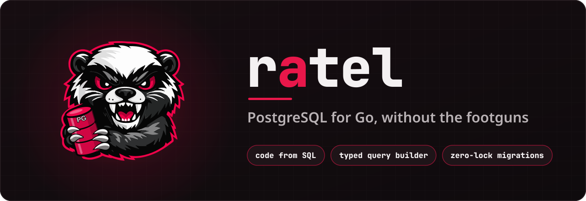
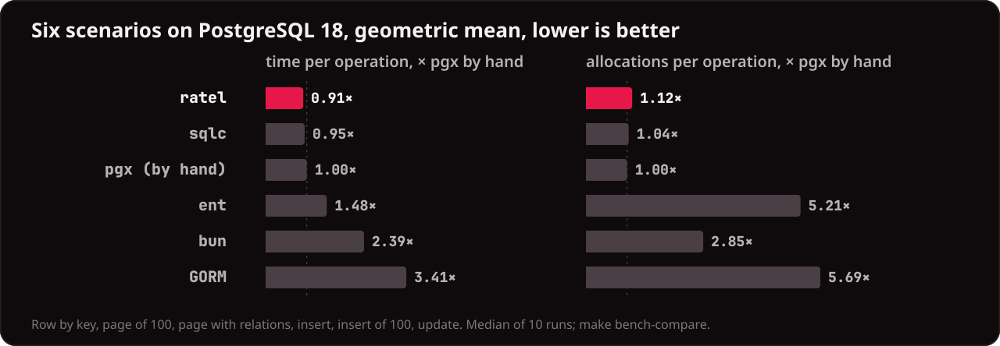

<p align="center">
  
</p>

<p align="center">
  <a href="https://github.com/gopherex/ratel/actions/workflows/ci.yml"></a>
  
  
  <a href="LICENSE"></a>
</p>

<p align="center">
  <a href="#quick-start">Quick start</a> ·
  <a href="#what-you-get">What you get</a> ·
  <a href="#benchmarks">Benchmarks</a> ·
  <a href="#roadmap">Roadmap</a> ·
  <a href="docs/architecture.md">Docs</a>
</p>

You write PostgreSQL: the schema as `CREATE` statements, the queries as SQL.
ratel generates typed Go code from them, gives you a query builder on Go 1.27
generic methods for everything a static query cannot express, and plans the
migrations from the schema files, so that applying them on a live database
never blocks your traffic. One driver (pgx v5), no reflection, no runtime
magic.

## Quick start

You need Go 1.27.3 or newer and Docker (ratel plans migrations on a
throwaway PostgreSQL container).

```sh
go install github.com/gopherex/ratel/cmd/ratel@latest

mkdir shop && cd shop
go mod init example.com/shop
ratel init                      # writes ratel.yaml, schema/, queries/, migrations/
```

**1. Describe the schema** in `schema/schema.sql`:

```sql
CREATE SCHEMA app;

CREATE TABLE app.users (
    id    bigint GENERATED BY DEFAULT AS IDENTITY PRIMARY KEY,
    email text NOT NULL UNIQUE,
    name  text NOT NULL
);

CREATE TABLE app.orders (
    id      bigint GENERATED BY DEFAULT AS IDENTITY PRIMARY KEY,
    user_id bigint NOT NULL REFERENCES app.users (id),
    total   numeric(12, 2) NOT NULL
);

CREATE INDEX orders_user_id_idx ON app.orders (user_id);
```

**2. Write the queries** you want as functions, in `queries/users/users.sql`:

```sql
-- name: UserByEmail :one
SELECT * FROM app.users WHERE email = @email;

-- name: TopCustomers :many
SELECT u.email, sum(o.total) AS spent
FROM app.users u JOIN app.orders o ON o.user_id = u.id
GROUP BY u.email
ORDER BY spent DESC
LIMIT @limit;
```

and list them in `ratel.yaml`:

```yaml
queries:
  - files: [queries/users/*.sql]
    package: users
```

**3. Generate the code and plan the first migration:**

```sh
ratel generate                  # internal/db/app (tables), internal/db/users (queries)
ratel migrate plan init         # migrations/<timestamp>_init.sql and ratel.sum
```

`plan` lints the schema as well: without the index above it stops with
`RTL-P01: FK columns without a supporting index: user_id`.

**4. Use it.** Apply the migrations on startup, then read and write through
the generated code:

```go
//go:embed migrations
var migrations embed.FS

dir, _ := fs.Sub(migrations, "migrations")
err := migrate.Apply(ctx, pool, dir) // no table is locked longer than a moment

db := ratel.New(pool)

// Insert, returning the rows with their generated ids.
created, err := db.Insert(app.Users,
	app.NewUserInsert("ann@example.com", "Ann"),
	app.NewUserInsert("bob@example.com", "Bob"),
).Returning(ctx)

// Typed builder with an eager relation: two queries, no N+1.
ann, err := db.From(app.Users).
	Where(app.Users.Email.Eq("ann@example.com")).
	With(app.Users.Orders).
	One(ctx)
orders, err := ann.Orders()

// A static query from queries/users/users.sql.
top, err := users.TopCustomers(ctx, db, 10)
```

Error checks are left out here. The complete program, with the pool setup
that registers the generated types, is
[examples/shop/main.go](examples/shop/main.go); CI runs it against
PostgreSQL.

When the schema changes, edit `schema/*.sql`, run `ratel generate` and
`ratel migrate plan <name>`, review the planned file, and deploy: the next
start applies it.

## What you get

**Code from SQL.** PostgreSQL's own parser (libpg_query as WebAssembly, no
cgo) reads the schema and queries; every parameter and column gets its Go
type and nullability (`ratel.Null[T]`). Enums, domains, composites, ranges
and arrays become Go types. Constraint violations are errors you match with
`errors.Is` against generated sentinels.
→ [input](docs/input.md), [runtime](docs/runtime.md)

**A typed query builder** for what a static query cannot express. Column
types are checked at compile time, and the SQL is schema-qualified with
numbered parameters. It covers joins, subqueries, keyset pagination,
streaming, `SKIP LOCKED`, upserts, `RETURNING`, batches and `COPY`.
Relations come from foreign keys and load in one query per depth.
→ [runtime](docs/runtime.md)

**Migrations that never lock production.** The schema files are the target
state. `ratel migrate plan` writes the steps in three phases:

- **expand:** `CONCURRENTLY` indexes, `NOT VALID` constraints, new columns;
- **backfill:** batched updates that pause while replicas lag;
- **contract:** drops and validations once old code is gone.

The runner checks for blocking sessions before it takes a lock, keeps DDL
short under `lock_timeout`, and resumes interrupted work. Renames and
retypes are declared as schema comments (`-- @ratel.renamed from=old`).
35 lint rules
(`RTL-*`) catch what the planner cannot fix.
→ [migrations](docs/migrations.md)

**Migrations inside your application.** `migrate.Apply` gives an embedded
directory the same guarantees as `ratel migrate apply`; `migrate.Check`
verifies it in a unit test. Hand-written steps start with
`ratel migrate new` and are sealed by `ratel migrate hash`.

**Tests on real PostgreSQL.** `rateltest` gives every test its own database,
cloned from a template migrated with your migrations.
→ [testing](docs/testing.md)

**Plugins in any language.** The generator is a plugin over a protobuf
contract and runs as an executable or WebAssembly. A `.proto` frontend
produces the same SQL schema.
→ [plugins](docs/plugins.md), [proto frontend](docs/proto-frontend.md)

**No telemetry of its own.** ratel only builds SQL and scans rows: trace
queries at the driver (a pgx tracer such as otelpgx).

## Benchmarks

The same schema and data (1000 users with 10 orders each) through six
libraries on PostgreSQL 18, each configured as its documentation advises for
speed. A test checks that all six read and write the same rows. Median of
10 runs; lower is better.

<p align="center">
  
</p>

ratel's builder costs about as much as the hand-written query it replaces:
the generated code scans without reflection, relations load in one query per
depth, and bulk inserts go through `unnest` arrays.

<details>
<summary>Per-scenario numbers and method</summary>

Time per operation:

| | pgx (by hand) | **ratel** | sqlc | ent | bun | GORM |
|---|---:|---:|---:|---:|---:|---:|
| row by primary key | 87 µs | **88 µs** | 87 µs | 110 µs | 258 µs | 332 µs |
| page of 100 rows | 122 µs | **88 µs** | 89 µs | 144 µs | 222 µs | 880 µs |
| page with relations (100 users, 1000 orders) | 648 µs | **575 µs** | 618 µs | 967 µs | 1625 µs | 2091 µs |
| insert one row | 34 µs | **36 µs** | 36 µs | 41 µs | 116 µs | 123 µs |
| insert 100 rows | 493 µs | **405 µs** | 496 µs | 529 µs | 1379 µs | 810 µs |
| update by primary key | 38 µs | **40 µs** | 38 µs | 142 µs | 55 µs | 116 µs |

Allocations per operation:

| | pgx (by hand) | **ratel** | sqlc | ent | bun | GORM |
|---|---:|---:|---:|---:|---:|---:|
| row by primary key | 15 | **17** | 14 | 119 | 79 | 134 |
| page of 100 rows | 421 | **418** | 420 | 604 | 760 | 1329 |
| page with relations | 3952 | **3475** | 3951 | 11428 | 9195 | 14467 |
| insert one row | 12 | **19** | 16 | 81 | 72 | 122 |
| insert 100 rows | 631 | **532** | 631 | 2988 | 746 | 1728 |
| update by primary key | 8 | **12** | 8 | 151 | 27 | 94 |

pgx and sqlc bulk-insert with `COPY`, which `unnest` outruns here; the
database/sql libraries run on pgx's stdlib driver over the same pool. Absolute numbers
depend on the machine (here an i5-14600K under load); compare the columns.
Reproduce with `make bench-compare`; the raw results are
[bench/results-table.txt](bench/results-table.txt), the method is in
[docs/testing.md](docs/testing.md#comparison-with-other-libraries).

</details>

## Roadmap

- **Go types as a schema source.** Declare tables as Go structs; a frontend
  turns them into the same annotated SQL schema, as `protoc-gen-ratel` does
  for `.proto` files, and generation and migrations work unchanged.
- **Versioned schemas.** During expand and contract, old and new application
  versions run side by side, each through its own view of the tables, with
  triggers keeping both in sync: renames and type changes without a window
  of incompatibility.
- **Online rebuild of large tables.** Changes that rewrite a table (its
  partitioning, the type of its primary key) through a shadow table filled
  in batches, kept in sync by triggers and swapped in atomically.
- **The PostgreSQL 18 grammar.** Generated virtual columns and `NOT NULL ...
  NOT VALID` in schema files, as soon as libpg_query ships the 18 grammar
  (the parser is on 17 today; plans already target 18 servers).

## Documentation

The specification lives in [docs/](docs/architecture.md):
[architecture](docs/architecture.md) ·
[input files and annotations](docs/input.md) ·
[runtime and generated code](docs/runtime.md) ·
[migrations](docs/migrations.md) ·
[CLI and ratel.yaml](docs/cli.md) ·
[Catalog IR](docs/ir.md) ·
[plugins](docs/plugins.md) ·
[proto frontend](docs/proto-frontend.md) ·
[testing](docs/testing.md)

## Development

```
*.go                    runtime package ratel (module github.com/gopherex/ratel)
migrate/                migration runner for applications and the CLI
rateltest/              test helpers for applications (own module)
cmd/ratel/              host CLI: parser, catalog, inference, generator, migration engine
cmd/protoc-gen-ratel/   proto frontend (own module)
proto/, ir/, plugin/    the protobuf contracts, their generated Go, the plugin SDK
tests/                  runtime integration suite (own module)
bench/                  the comparison with other libraries (own module)
examples/shop/          the quick start (own module)
tools/                  the generator of the README banner and benchmark chart
docs/                   the specification
```

```sh
make setup             # install the pinned golangci-lint and easyp into ./bin
make check             # format check + linter + unit tests (what CI runs)
make test-integration  # integration suites on Docker (postgres:18-alpine)
make bench             # every benchmark of every module
make bench-compare     # the comparison table above
make readme-art        # redraw the banner and the chart (needs python3, inkscape)
```

`make lint` covers the integration suites too, and `make fmt` hands each
module only its own files (a bare `golangci-lint fmt` at the root rewrites
the nested modules). `RATEL_PG_IMAGE=postgres:16-alpine make
test-integration` runs the suites on another PostgreSQL. Generated Go is
committed; `make proto` and `make bench-gen` regenerate it.

## License

[MIT](LICENSE). PostgreSQL is a registered trademark of the PostgreSQL
Community Association of Canada; ratel is not affiliated with it.
